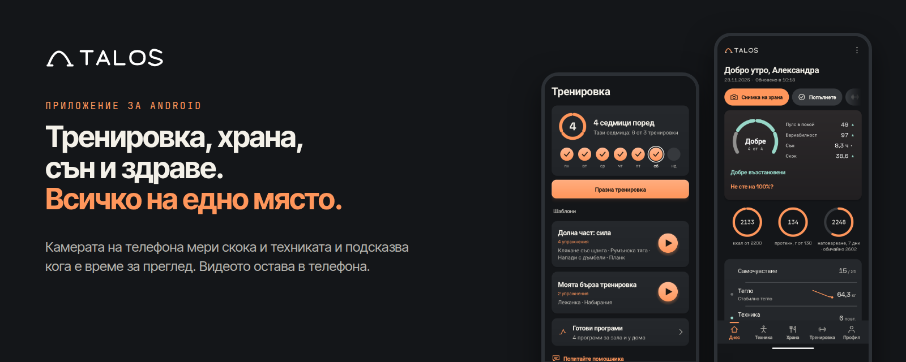
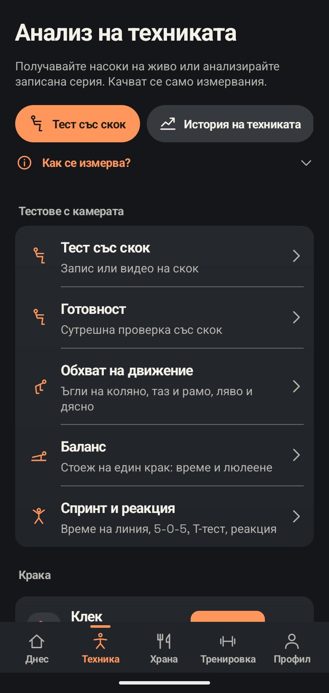
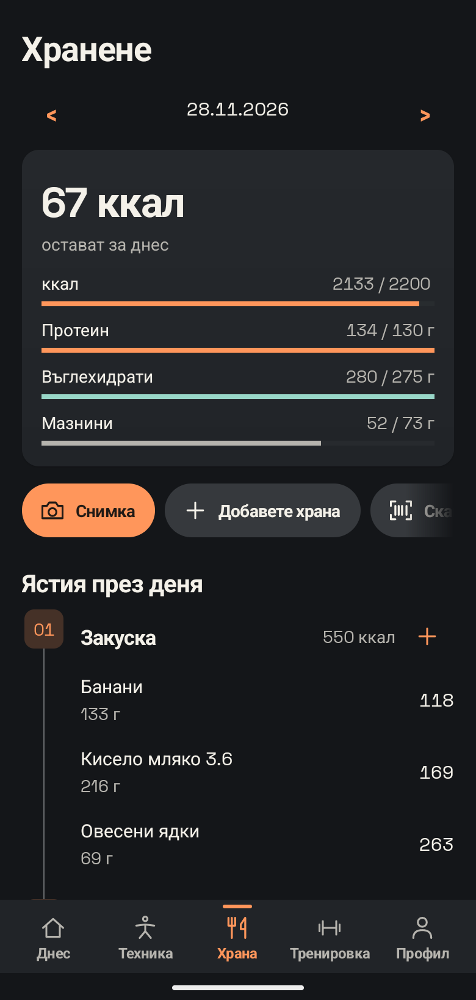
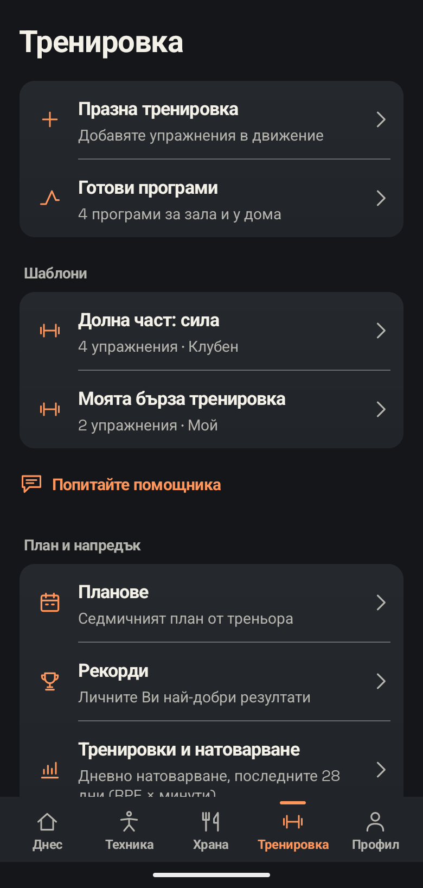
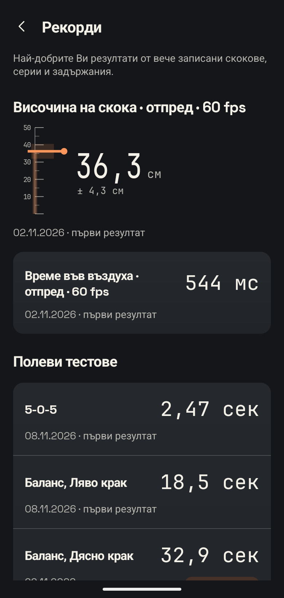
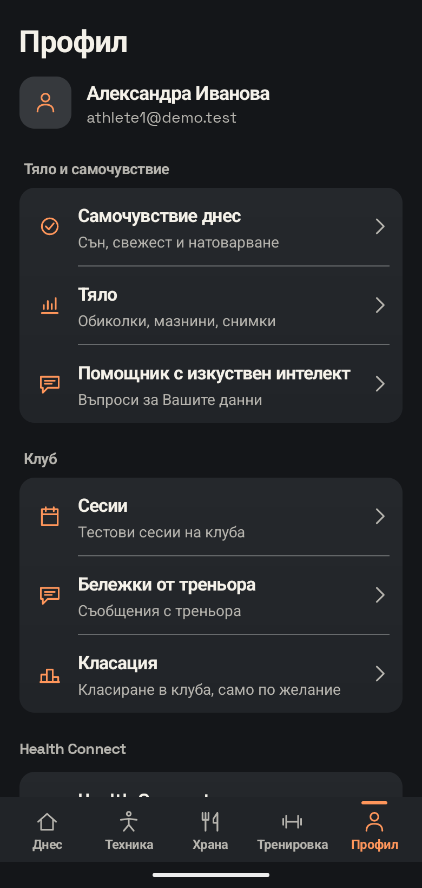
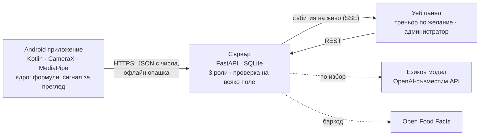

<div align="center">



**[Опитайте на живо](https://talos.stormlabs.cloud)**  ·  [Документация](Talos-документация.pdf)  ·  [Презентация](Talos-презентация.pdf)  ·  [Диплянка](Talos-диплянка.pdf)  ·  [Изтеглете APK](https://github.com/storm546/talos/releases/latest)


</div>

---

## Накратко

Talos е лично приложение за тренировка, храна, сън и здраве. Записвате тренировките и седмичната си
серия, храната с баркод или снимка, съня и готовността за деня. Камерата на телефона брои повторенията,
проверява техниката и мери скока, **в самия телефон**: видеото не излиза от него.

- **Тренировка и храна.** Шаблони, таймер за почивка, рекорди и седмична серия; каталог с 13 588 храни, баркод, снимка на чинията и цели по макронутриенти.
- **Сън и готовност.** Пулс в покой, вариабилност, сън и натоварване, сравнени със собствените Ви последни 28 дни.
- **Сигнал за преглед.** Ако в 3 скока подред коленете влизат навътре при приземяване, Talos предлага преглед при спортен лекар или физиотерапевт. Сигнал, не диагноза; при здрави хора не се появи (0 от 25 поредици).
- **Проверено срещу лаборатория.** Срещу силова платформа от 91 скока 64 получават число без предупреждение и нито едно не е грешно.

<table>
<tr>
<td width="220" align="center"></td>
<td>

### Опитайте

1. Насочете камерата към кода или отворете [talos.stormlabs.cloud](https://talos.stormlabs.cloud).
2. Влезте с тестов акаунт: администратор, треньор или спортист ([testovi-akaunti.md](docs/testovi-akaunti.md)).
3. За телефона: изтеглете подписания APK от [Releases](https://github.com/storm546/talos/releases/latest) (Android 8.0+).

<sub>Демонстрационните акаунти и данни са измислени и се възстановяват всяка нощ.</sub>

</td>
</tr>
</table>

## Какво прави

| | |
|---|---|
| **Тест със скок** | Клип от 10 секунди дава височина, време на полет, сгъване на коленете, колене навътре и асиметрия, всяко с допуск. При съмнение приложението моли да проверите кадрите, вместо да покаже грешно число. |
| **Сигнал за преглед** | Ако в 3 скока подред коленете влизат навътре (разстоянието между тях е под 60 % от това между глезените), Talos предлага преглед при спортен лекар или физиотерапевт. |
| **Техника** | Броене на повторения и задържане на живо или от видео за 20 упражнения; обхват на движение, баланс, спринт и реакция. Доказани са клекът и планкът; останалите са отбелязани „Експериментални“ с причината. |
| **Храна** | Каталог с 13 588 храни (USDA, CC0), баркод чрез Open Food Facts, снимка на чинията, рецепти, адаптивни цели без опасен дефицит за непълнолетни. |
| **Тренировка** | Серии с таймер за почивка, интервали (Табата, EMOM, AMRAP), програми, калкулатори, рекорди и седмична серия: седмици подред с всички планирани тренировки. |
| **Днес и готовност** | Пулс в покой, вариабилност, сън, самочувствие и натоварване, сравнени с последните 28 дни и обяснени с думи. |
| **Треньор (по желание)** | Ако тренирате с треньор, той вижда същите числа в уеб панел на живо, с групи, тестови сесии и бележки. |
| **AI помощник** | Езиков модел (локален или облачен) предлага действия с правата на потребителя; нищо не се записва без „Потвърдете“. |

<p align="center">





</p>

## Как работи



- **Едно ядро.** Формулите и броенето са в библиотека на Kotlin (`core/`), която работи и на телефона, и в инструмента за проверка срещу лабораторните данни. Числото на телефона е точно това, което е проверено.
- **Строг договор.** Сървърът приема само описаните полета и проверява границите им; непознато поле връща 422, чужд клуб връща 404.
- **Работи без интернет.** Резултатите чакат в опашка на телефона и се изпращат по-късно с уникален номер, без дубликати.
- **На живо.** Нов скок, отчет или бележка се появяват в панела на треньора веднага, чрез Server-Sent Events, които носят само вид и номер.

Подробно: [документацията](Talos-документация.pdf) и [архитектурата](docs/img/arhitektura.svg).

## Измерено

Всяко число идва от [docs/validacia.md](docs/validacia.md), където са методът и данните.

| Какво | Еталон | Резултат |
|---|---|---|
| Откриване на скока | Силова платформа, набор на Университета в Твенте: 9 души, 91 скока, всеки човек проверен с модел, който не го е виждал | Отпред: 64 числа без предупреждение, нито едно грешно; 7 с предупреждение. Отстрани: 58 верни и 2 грешни |
| Време на полет и височина | Същата силова платформа | Отпред средна грешка 32 ms, около един кадър (около 3 cm при скок от 15 cm) |
| Сгъване на коляното | Лабораторна кинематика (OpenSim) | Средноквадратична грешка 17° отпред и 10° отстрани |
| Сигнал за преглед | Здрави хора от същия набор (4 души отпред) | 0 сигнала в 25 поредици по 3 скока. Дали хваща истински риск, още не е проверено |
| Фалшиви сигнали | 400 видеа от уебкамера без скок | 3–7 % |
| Броене на клекове | 22 отделени серии, 12 души | 21 точно → валидирано |
| Планк | 9 задържания | 9 в допустимото време → валидирано |
| Напад (нов алгоритъм) | 36 отделени серии, 25 души | Точен брой от запис от 22 % на 64 %; остава експериментален |

Числата са за сравнение на спортиста със самия него във времето, не за диагноза.
Данни: Zenodo 6644593 и 7422031 (CC BY 4.0, Huawei Wang); Kaggle „Gesture Video Dataset for Jump Classification“ (CC BY 4.0).

## Стартиране

Сървърът (Python 3.13):

```bash
python3.13 -m venv server/.venv
server/.venv/bin/pip install -r server/requirements.txt
server/.venv/bin/python -m server.seed          # демонстрационен клуб и акаунти
server/.venv/bin/uvicorn server.main:app --port 8000
```

Панелът е на `http://127.0.0.1:8000/`. С Docker: `docker compose up -d --build` (порт 8171).
Разгръщане зад HTTPS: [deploy/README.md](deploy/README.md).

Приложението (JDK 17 и Android SDK 35):

```bash
./gradlew :app:assembleDebug      # app/build/outputs/apk/debug/app-debug.apk
```

## Хранилището

```text
app/        Android приложението (Kotlin): камера, MediaPipe, екрани, офлайн опашка
core/       ядро на Kotlin: формули, броене на повторения, каталог на упражненията, проверка
server/     FastAPI сървър, база SQLite, уеб панел, каталог на храните, тестове
deploy/     systemd, Docker и обратно прокси
docs/       документацията за турнира, проверката на точността, формулите, изображенията
```

## Тестове

- **Сървър:** 707 минаващи теста (pytest): роли и права, проверка на всяко поле, атаки, миграции на базата.
- **Ядро:** 108 теста (JUnit): формули, сигнал за преглед, броене, едно и също число на живо и от видео.
- **Приложение:** проверки на емулатор за входа, всички екрани и двата езика.
- **CI:** [ci.yml](.github/workflows/ci.yml) описва за GitHub Actions тестовете на сървъра и ядрото и сглобяването на приложението.

## Материали за журито

| | |
|---|---|
| [Документация](Talos-документация.pdf) | описанието на проекта по Приложение 1 на регламента, пет страници |
| [Презентация](Talos-презентация.pdf) | защитата, 14 слайда; [сценарий на демото](docs/scenarii-demo.md) |
| [Диплянка](Talos-диплянка.pdf) | A4, за печат |
| [Ръководство](docs/rakovodstvo.md) · [Проверка](docs/validacia.md) · [Формули](docs/formuli.md) | как се използва, колко е точно, как се смята |
| [Тестови акаунти](docs/testovi-akaunti.md) · [Лицензи](LICENSES-AUDIT.md) | акаунт за всяка роля; лицензите на всички зависимости |

PDF файловете се генерират от `docs/` с `node docs/build.cjs` (A4, Times New Roman 12, междуредие 1,5).

## Следва

- Проверка на сигнала за преглед с физиотерапевт и с данни от хора с контузия.
- Още упражнения да минат прага за валидиране с нови, непознати данни.
- Измерване на скоростта и батерията на реален телефон.
- Публикуване в Google Play.

## Автор и лиценз

Адриан Пламенов Атанасов, XII клас, ГПЧЕ „Ромен Ролан“, Стара Загора. Ръководител: Ивелина Глинджурска.
Проект за направление „Разпределени приложения“ на турнира „Джон Атанасов“ 2026.

Свободен софтуер под [GPL-3.0](LICENSE). Външните компоненти запазват своите лицензи: MediaPipe и моделът
за поза (Apache-2.0), AndroidX и Kotlin (Apache-2.0), FastAPI (MIT), шрифтовете Space Grotesk, JetBrains Mono
и Inter Tight (OFL); пълният списък е в [LICENSES-AUDIT.md](LICENSES-AUDIT.md).
