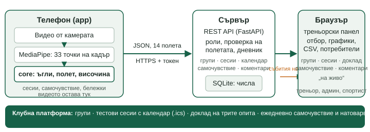
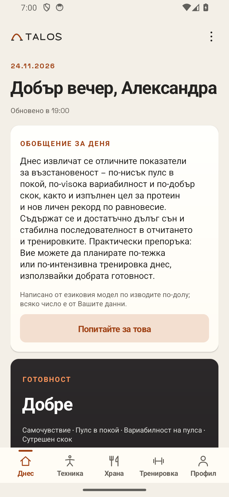
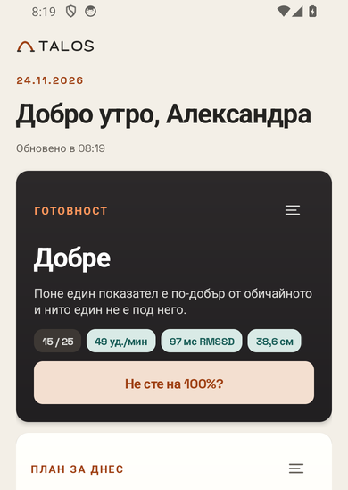
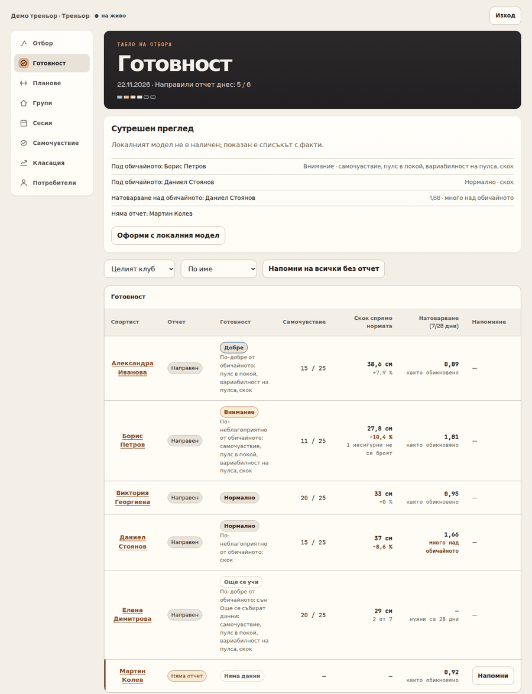

# Talos: личен фитнес инструмент с честни измервания и клубен сървър

Документация за Национален есенен турнир по информационни технологии „Джон Атанасов“,
направление „Разпределени приложения“, XI–XII клас.

## 1. Тема

Talos е личен фитнес инструмент с честни измервания: телефонът измерва скока и движенията на самото устройство, клубният сървър показва на спортиста и треньора промяната спрямо собствената му база, а всяко число казва колко може да греши. Основният
инструмент измерва скок по обикновено видео от телефон: позата се намира и числата се смятат на самото
устройство, а към клуба се изпращат само числата. Около него са останалите инструменти: тренировка с
таймер за почивка, интервален таймер и калкулатори, хранене, готовност и натоварване, рекорди, тестови
сесии, бележки от треньора и AI помощник. Системата е разпределена: Android приложение, уеб панел,
сървър с база данни, поток от събития на живо и по избор езиков модел (локален или облачен).

## 2. Автори

- [ИМЕ НА АВТОРА], [КЛАС], [УЧИЛИЩЕ], тел. [ТЕЛЕФОН], [ИМЕЙЛ]
- [ИМЕ НА ВТОРИЯ АВТОР], [КЛАС], [УЧИЛИЩЕ], тел. [ТЕЛЕФОН], [ИМЕЙЛ]

По правилник авторите са най-много двама. Ако проектът се предава от един автор, вторият ред се
изтрива.

## 3. Ръководител

[ИМЕ НА РЪКОВОДИТЕЛЯ], [ДЛЪЖНОСТ], [УЧИЛИЩЕ], тел. [ТЕЛЕФОН], [ИМЕЙЛ]

## 4. Резюме

### 4.1 Цели, анализ на потребностите и съществуващи решения

Механиката на скока и приземяването се измерва в лаборатория: оптична система с маркери и силови
платформи, скъпа апаратура и специалист. Малкият клуб няма такива. Треньорът гледа на око, а
тренировките, храненето и самочувствието на спортистите се водят в различни приложения или на хартия.

Търговските системи за скок стъпват на силова платформа или сензори по тялото. Публикуваните
изследвания с видео от телефон (MediaPipe срещу Kinect V2, doi:10.1007/s11548-024-03156-5; OpenCap,
doi:10.1177/17479541261461182) обработват видеото на сървър или компютър и нямат клубна среда.
Приложенията за тренировки и хранене са отделни и не дават на треньора общ поглед върху отбора.

Целите са: числа за скока от един телефон, без видео извън устройството; честно измерена и
публикувана точност; инструменти за всеки ден (тренировка, хранене, готовност), полезни и поотделно;
общ клубен сървър с роли, така че треньорът да вижда отбора и промяната спрямо собствената базова
стойност на всеки спортист.

### 4.2 Основни етапи и роли на авторите

Етапи: проучване и избор на модел за поза; математическо ядро с тестове; сървър с права и база;
мобилно приложение; валидация срещу лабораторни данни; клубна платформа (групи, сесии, самочувствие,
бележки); техника, тренировки, хранене и AI помощник; рекорди и класация; набор инструменти (вълна 1:
тренировка, таймери, калкулатори; вълна 2: готовност и натоварване; вълна 3: полеви тестове); документация.

[АВТОР: разпределение на работата между авторите и лично изявление за приноса]

### 4.3 Ниво на сложност и основни проблеми

**Измерване с една камера.** Камерата не вижда дълбочина, затова ъгълът се смята от триизмерните
точки на модела, а те са оценка: прав крак се чете като 10 до 17 градуса сгъване. Приземяването трае
100–200 ms (3–6 кадъра), а един пропуснат кадър мести времето на полет с цял интервал. Затова отскокът
и приземяването се намират от правила и се проверяват от малка обучена мрежа (около 16 300 тегла, на
телефона); при несъгласие има предупреждение, а не число.

**Разпределена система с прекъсваща връзка.** Телефонът в залата често е без мрежа. Резултатите
влизат в опашка и се изпращат по-късно; всеки носи случаен `client_id`, така че повторното изпращане
не създава дубликат. Тренировка, записана офлайн, се изпраща преди сериите си, а сериите я посочват
по нейния `client_id`, защото номерът ѝ на сървъра още не е известен.

**Права и поверителност.** Данните са на непълнолетни. Всяко четене и писане проверява ролята и клуба
(чужд клуб връща 404); сървърът не приема данни на спортист без записано съгласие. Потокът от събития
носи само вида и номера на обекта, без стойности. Езиковият модел работи с правата на влезлия
потребител и само предлага промени; записва се едва след потвърждение.

**Честни оценки.** Готовността, натоварването и разходът на енергия са оценки. Всяка показва „още се
учи“, докато няма достатъчно данни, обяснява какво я е определило и не използва медицински думи.

### 4.4 Логическо и функционално описание

`core` е библиотека на Kotlin с цялата математика: скок, техника на упражненията, калкулатори и
интервални планове. Няма мрежа и интерфейс, затова се тества отделно и същият код работи и в
пакетния валидатор. `app` е Android приложението с три части (техника с камера, храна, тренировка), а „Днес“ показва
данните с изводите на сървъра и обобщение от езиковия модел. `server`
е REST API с база SQLite, поток от събития (Server-Sent Events) и статичен уеб панел. Роли: `admin`
(всичко), `coach` (своя клуб), `athlete` (собствените данни).

Фиг. 1. Частите на системата. Видеото остава на телефона; по мрежата минават числа.

Договорът за скока е JSON обект с 14 полета (вид тест, кадри в секунда, време на полет, височина,
сгъване на коленете, ъгъл в челната равнина, асиметрия, качество, предупреждения). Сървърът проверява
типа и границите на всяко поле и отхвърля непознати полета с 422.

Инструменти и модули:

- **Тест със скок** (основният): запис или видео, резултат с предупреждения, ръчна проверка на кадрите,
  история спрямо базовата стойност; сутрешна проверка с 2–3 скока за готовността.
- **Техника**: на живо или от запис, с брояч и указания. Валидирани са само броят на клековете и
  времето на задържане в планк; останалите 18 упражнения са „Експериментални“.
- **Тренировка**: празна, от шаблон или от плана за деня; серии с тежест, повторения и усилие (RPE),
  таймер за почивка в услуга на преден план, суперсерии, обобщение. **Интервален таймер** (интервали,
  Табата, EMOM, AMRAP, хронометър) и **калкулатори** (дискове, максимум за едно повторение по Епли и
  Бжицки, загрявка) работят изцяло на телефона. Треньорът задава седмични планове с предложение за
  прогресия, което не се прилага само. Библиотека от 36 упражнения и четири готови програми като шаблони.
- **Хранене**: каталог на USDA (13 588 храни, CC0) с търсене на български и английски, търпимо към
  правописни грешки, порции, рецепти и микронутриенти;
  баркод — сървърът търси в Open Food Facts; описано с думи или снимано хранене се разчита от езиковия модел и се
  записва след потвърждение, а снимка на хладилника дава продукти, до три рецепти и магазини наблизо
  (OpenStreetMap, ODbL). Адаптивна оценка на разхода с интервал от грешката на тренда, седмична
  програма и цел по тренда на теглото,
  с минимум 1500 kcal и без дефицит за непълнолетен без треньор.
- **Тяло**: обиколки и мазнини по формулата на ВМС на САЩ с нейната грешка (± 3,5–3,7 пункта); снимките на
  напредъка остават само на телефона.
- **Готовност и натоварване**: лични базови стойности за 28 дни на пулс в покой, вариабилност на пулса,
  самочувствие и сутрешен скок (пулсът и вариабилността — като средно за 7 дни); резултат за съня;
  натоварване по RPE × минути: сбор за 7 дни и обичайна седмица, а отношението 7/28 дни е второстепенно. Треньорът вижда табло на отбора, праща напомняне и чете сутрешен преглед.
- **Полеви тестове** (с камерата и GPS на телефона): обхват на движение в коляното, таза и рамото
  (ляво/дясно, грешка ±10°, само коляното е сравнено с еталон), баланс на един крак (време и люлеене),
  спринт, 5-0-5, Т-тест и реакция по пресичане на линия в кадъра (точност един кадър), кардио навън с
  разстояние, темпо и километри. Маршрутът и кадрите остават на телефона.
- **Рекорди и класация**: лични рекорди от вече записаните данни; нов рекорд при скок само над най-малката
  откриваема промяна (отпред 11,3 см, отстрани 5,1 см), в същия изглед и честота на кадрите; клубна класация само за включилите
  се (за непълнолетен — и с потвърждение от треньора).
- **Клуб**: групи, тестови сесии с календар (.ics) и доклад, ежедневно самочувствие, бележки от
  треньора, обновяване на панела на живо.
- **AI помощник**: отговаря по данните на потребителя и предлага записи; нищо не се променя без
  „Потвърдете“, а потвърждението проверява правата отново.

### 4.5 Реализация: технологии, алгоритми, източници

Kotlin/JVM за ядрото (същият код на телефона и във валидатора); Android с minSdk 26, MediaPipe Pose
Landmarker (тежък модел за видео, лек за живо проследяване), CameraX и ML Kit за баркод (вграден модел,
без мрежа). Python 3.13 с FastAPI и SQLite за сървъра; пароли със scrypt и сол; потокът от събития се
чете с `fetch`, така че токенът не попада в адрес. Езиковият модел е зад съвместим с OpenAI адрес
(`JUMPSCAN_LLM_URL`, резервни модели в `JUMPSCAN_LLM_FALLBACK`): локален модел или облачна услуга; при
облачна услуга въпросите и прочетените данни напускат клубния сървър, затова данни на спортисти под 18
години не се изпращат натам (отказ 403 за тях, филтър в отговорите за треньора). Без модел помощникът връща 503, а останалото работи. Снимка на храна се изпраща само когато потребителят пусне анализа, намалена до 1024 px и без EXIF, и сървърът не я записва на диск, в база, журнал или одит.

Алгоритми (подробно в `formuli.md`): ъгли от триизмерните точки; височина h = g·t²/8 от времето на
полет; базова стойност и „по-различно от обичайното“ при разлика над 0,5 стандартни отклонения и
типичната грешка (Hopkins 2000; Plews 2013; Buchheit 2014); сутрешен скок (Claudino 2017); сън
(Hirshkowitz 2015; Phillips 2017); монотонност и натоварване (Foster 1998, 2001); отношение 7/28 с
експоненциални средни (Williams 2017), показвано като сравнение, не като прогноза.

Данни: наборът на Университета в Твенте (Zenodo 6644593 и 7422031, CC BY 4.0, Huawei Wang) за
скока; USDA FoodData Central (CC0); Open Food Facts (ODbL, източникът се пази при всяка сканирана храна).

### 4.6 Описание на приложението

Системата работи на https://jumpscan.stormlabs.cloud (сървър и уеб панел; приложение 1.4.0-beta23).
Тестовите акаунти за всяка роля са в `testovi-akaunti.md`, паролата е `demo1234`, данните са
синтетични. Локално: `pip install -r server/requirements.txt`, `python -m server.seed` и `uvicorn
server.main:app`; за постоянна работа има `Dockerfile`, `docker-compose.yml` и systemd услуга
(`deploy/README.md`). Приложението се компилира с `./gradlew :app:assembleDebug` и върви на Android 8.0+.

Спортистът заснема скок и вижда числата при потвърден полет; при съмнение отваря „Проверете
кадрите“. На „Днес“ вижда изводите за деня, а от разделите стига до тренировката и храненето.
Треньорът в браузъра вижда отбора, историята с базовата стойност, таблото „Готовност“, сесиите,
плановете, храненето и класацията; новите записи се появяват без презареждане.

Фиг. 2. Отляво надясно: проверка на кадрите на скока; „Днес“ с изводите; готовност на спортиста; таблото на треньора.

### 4.7 Заключение

Резултатът работи от край до край: видео на телефона, числа на екрана, запис в клубния сървър и
поглед на треньора, с инструментите за всеки ден около тях. Скокът е проверен срещу силова платформа
(девет души, 91 скока, всеки човек с модел, който не го е виждал; `validacia.md`): отпред 64 скока
получават число без предупреждение и нито едно не е грешно, отстрани 58 верни и 2 грешни. Ъгълът на
сгъване греши с около 17 градуса отпред и 10 отстрани, затова служи за сравнение на спортиста със
самия него. Броенето на клекове е точно в 21 от 22 отделени серии (12 души), а времето в планк е в
допустимото в 9 от 9. Преминават 706 сървърни теста (1 пропуснат) и 104 теста на ядрото (24.11.2026 г.). Не са измерени: скоростта и батерията на реален телефон, работата с екрана
изключен и използване от истински клуб; следва проверка на Galaxy A54.
