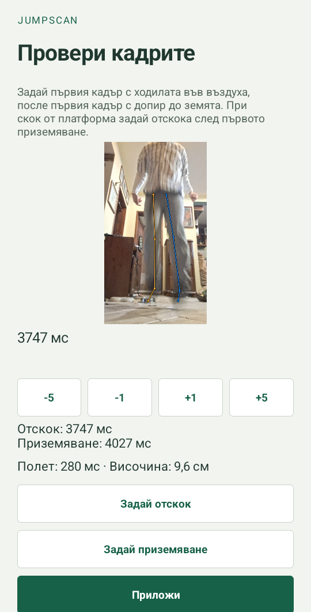
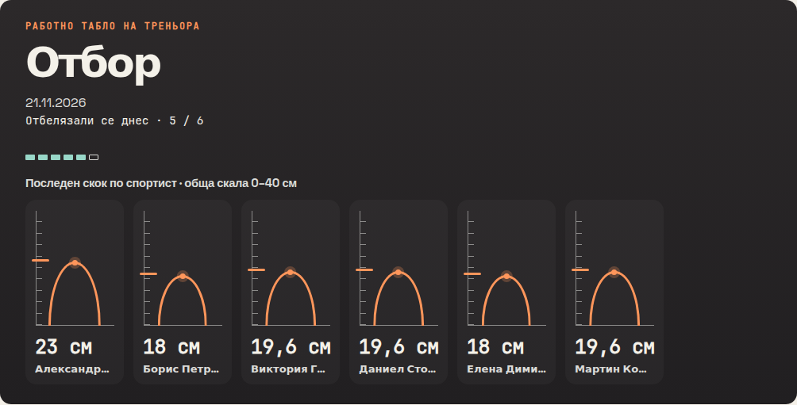

# JumpScan: клубна платформа за анализ на механиката на приземяване от видео на телефон

Документация за Национален есенен турнир по информационни технологии „Джон Атанасов“,
направление „Разпределени приложения“, XI–XII клас.

## 1. Тема

JumpScan е клубна платформа, построена около един основен модул — анализ на механиката на
приземяване по обикновено видео от телефон. Системата е от три части: мобилно приложение (с
изчисленията за анализа), клубен сървър и треньорски панел в браузър. Видеото се анализира на
самото устройство и не го напуска; към клуба се изпращат само числа. Треньорът вижда историята на
всеки спортист и промяната спрямо собствената му базова стойност. Около анализа платформата
добавя и работната среда на един клуб: групи, тестови сесии с изнасяне в календар и доклад на
трите опита, ежедневно самочувствие с натоварване, бележки от треньора и обновяване на панела на
живо.

## 2. Автори

- [ИМЕ НА АВТОРА], [КЛАС], [УЧИЛИЩЕ], тел. [ТЕЛЕФОН], [ИМЕЙЛ]
- [ИМЕ НА ВТОРИЯ АВТОР], [КЛАС], [УЧИЛИЩЕ], тел. [ТЕЛЕФОН], [ИМЕЙЛ]

По правилник авторите са най-много двама. Ако проектът се предава от един автор, вторият ред се
изтрива.

## 3. Ръководител

[ИМЕ НА РЪКОВОДИТЕЛЯ], [ДЛЪЖНОСТ], [УЧИЛИЩЕ], тел. [ТЕЛЕФОН], [ИМЕЙЛ]

## 4. Резюме

### 4.1 Цели, анализ на потребностите и съществуващи решения

Оценката на механиката на приземяване днес се прави в лаборатория: оптична система с маркери и
силови платформи. Това дава точни числа, но изисква апаратура за десетки хиляди левове,
специалист и отделено време. Малък клуб не разполага с нито едно от трите. Треньорът гледа
приземяването на око, сравнява го с паметта си и не разполага с история в числа.

Съществуват и по-достъпни решения. Търговските системи за анализ на скок стъпват на силова
платформа или на сензори по тялото и остават скъпи. В научната литература вече има публикувани
изследвания, които автоматизират оценката на грешки при приземяване по видео от телефон с отворени
модели за оценка на поза — MediaPipe, OpenPose, OpenCap. Две от тях са най-близки до нашия подход:
приложение с MediaPipe, сравнено с Kinect V2 (doi:10.1007/s11548-024-03156-5), и автоматизирано
оценяване на грешки при приземяване с OpenCap (doi:10.1177/17479541261461182). Тези работи
обработват видеото на сървър или на работна станция и не предлагат клубна среда с роли.

JumpScan се различава по три неща: анализът се извършва на телефона, без видео да излиза от него;
сървърът е клубен и има три роли с различни права; точността е измерена срещу лабораторни данни и
е публикувана в тази документация, вместо да бъде обещана.

Целите на проекта са пет: числа от един телефон без лаборатория; никакво видео извън
устройството; клубна история и сравнение на всеки спортист със самия него; честно описана точност;
работна среда за клуба — групи, сесии, самочувствие и обратна връзка — около самия анализ.

### 4.2 Основни етапи и роли на авторите

Работата мина в шест етапа: проучване и избор на модел за оценка на поза; математическо ядро с
тестове; сървър с права и база данни; мобилно приложение; валидация срещу лабораторни данни;
клубна платформа, документация и подготовка за защита.

[АВТОР 1] — математическото ядро и мобилното приложение. [АВТОР 2] — сървърът, правата и
треньорският панел. Двамата заедно — валидацията, тестовете и документите. [ПРОВЕРИ: точното
разпределение между авторите]

### 4.3 Ниво на сложност и основни проблеми

Проектът е труден в три посоки.

Първата е измерването. Една камера не вижда дълбочина. При изглед отпред коляното се сгъва към
камерата и по изображението това почти не личи, затова ъгълът се смята от триизмерните точки на
модела, а те са оценка, не измерване; прав крак се чете като 10 до 17 градуса сгъване (отпред, девет
души). Втората е времето: приземяването трае 100 до 200 ms, или три до шест кадъра при 33 кадъра в
секунда. Един пропуснат кадър на ръба мести резултата с цял интервал, затова детекторът работи с
медианен филтър, праг, съобразен с дължината на крака, и предупреждение при несигурен ръб. Третата е
поверителността. Видеото е на непълнолетни спортисти в зала. Затова към сървъра пътува
само JSON с числа, без видео, без изображения и без сурови точки от позата; всеки спортист може да
изтрие собствените си данни. Същият принцип важи и за модулите на платформата: дори потокът от
събития на живо пренася само кой обект се е променил и кога, без числа и без текст.

### 4.4 Логическо и функционално описание

Системата има три части с писмен договор между тях.

`core` — библиотека на Kotlin, в която живее цялата математика. Получава кадри с 33 точки на
MediaPipe и връща обект с числата. Няма връзка с мрежа, интерфейс или база данни, затова се тества
изолирано.

`app` — Android приложение. Анализът е неговият основен екран: избор на тест и заснемане или избор
на клип, анализ с прогрес, резултат с числата и предупрежденията, проверка на кадрите на отскока и
приземяването, история. Приложението извиква `core` и изпраща готовия JSON. Екраните на клубната
среда са: предстоящите сесии на началния екран (избраната сесия прикачва резултата към нея и
показва „опит n от m“), ежедневно самочувствие с пет оценки и незадължителни минути тренировка и
усилие, и бележките от треньора с брояч на непрочетените и поле за отговор.

`server` — REST API на Python с база SQLite и статичен треньорски панел. Съхранява потребители,
клубове, токени и скокове. Всеки потребител принадлежи на един клуб и има една от три роли:
`admin` (всичко), `coach` (своя клуб), `athlete` (собствените си данни).

Фиг. 1. Трите части, модулите на платформата и потокът на данните. През мрежата минават само числа.

Договорът е един JSON обект с 14 полета: вид тест, кадри в секунда, време на полет, височина на
отскока, сгъване при контакт и пиково сгъване за всеки крак, FPPA за всеки крак, отношение
колене/глезени, асиметрия, качество и списък с предупреждения. Сървърът приема само този обект, с
проверени граници за всяко поле и с отхвърляне на непознати полета.

Модулите на платформата преизползват същите роли, права, дневник и проверки:

- **Групи** — тренировъчни групи вътре в клуба; един спортист може да е в няколко.
- **Сесии** — планирани тестови сесии с начален час, място, вид тест и брой опити; всяка може да е
  за група или за целия клуб. Всеки потребител изнася видимите си сесии в календарен файл (.ics).
- **Доклад на сесия** — за всеки спортист в обхвата се показват изпълнените опити от заложените и
  медианите на числата от скоковете в сесията.
- **Самочувствие** — ежедневно отбелязване с пет оценки от 1 до 5 (където 5 е най-добре) и
  незадължителни минути тренировка и усилие; треньорът вижда отбора за избран ден със сума на
  петте и натоварване.
- **Бележки от треньора** — бележки от треньора за всеки спортист, евентуално свързани със скок или
  сесия; спортистът вижда непрочетените и може да отговаря.
- **Обновяване на живо** — панелът се свързва с поток от събития и опреснява отворения изглед при
  нов скок, отбелязване или бележка, без презареждане.

### 4.5 Реализация: технологии, алгоритми, източници

Kotlin/JVM за ядрото, защото същият код се изпълнява и на телефона, и в пакетния валидатор на
компютъра — числата в тази документация са получени от същия анализатор, който работи в
приложението. Android с minSdk 26 и MediaPipe Pose Landmarker, тежкият вариант на модела: той е
единственият, който проследява краката през целия полет и при трите собствени клипа. Моделът е
предварително обучен и работи на устройството; собствено обучение не е правено. Python с FastAPI,
SQLite и стандартната библиотека за хеширане на пароли покриват сървъра с малко зависимости.
Потокът от събития на живо е Server-Sent Events, зареден с обикновен `fetch` върху същия токен,
така че токенът никога не попада в адрес или лог.

Алгоритмите са описани подробно във файла `formuli.md`. Накратко: ъгълът на сгъване е ъгълът между
бедро и подбедрица от триизмерните точки; FPPA е същият ъгъл върху изображението, подписан спрямо
средната линия; отношението колене/глезени сравнява разстоянието между колената с това между
глезените; асиметрията е относителната разлика между краката; времето на полет е от първия кадър във
въздуха до първия кадър на контакт, а височината следва по h = g·t²/8. Отскокът и приземяването се
намират от правила и се проверяват от малка обучена невронна мрежа (около 16 300 тегла, на телефона):
при съгласие се взима средното, при несъгласие се показва предупреждение.

Източници на данни и на подхода: наборът на Университета в Твенте със синхронизирано видео,
оптична кинематика и силови платформи (Zenodo 6644593 и 7422031, лиценз CC BY 4.0, автор Huawei
Wang) и двете публикации, посочени в 4.1. DOI: 10.5281/zenodo.6644593 и 10.5281/zenodo.7422031.

### 4.6 Описание на приложението

Стартиране на сървъра: `pip install -r server/requirements.txt` (Python 3.13), после
`python -m server.seed` за демонстрационните данни и `uvicorn server.main:app`. Базата се намира на
пътя от променливата `JUMPSCAN_DB`, по подразбиране `server/jumpscan.db`.

За постоянно работещ сървър има `Dockerfile` и `docker-compose.yml` (контейнерът държи базата в том и
се публикува само на `127.0.0.1:8171`) и systemd услуга за машини без Docker. Шифроването на връзката
се поема от обратен прокси на хоста. Стъпките са в `deploy/README.md`. [ПРОВЕРИ: разгърната ли е системата и на кой адрес]

Инсталиране на приложението: компилира се с Gradle (`./gradlew :app:assembleDebug`) и се инсталира
върху Android 8.0 или по-нов. В екрана за вход се въвеждат адресът на сървъра, имейлът и паролата.

Използване: спортистът избира вида тест, заснема клип или избира готов, изчаква анализа и вижда
числата. С „Провери кадрите“ минава кадър по кадър и поправя отскока и приземяването, както в метода
на ръчно отбелязване на My Jump (doi:10.1080/02640414.2014.996184); така се получава резултат и
когато полетът не е намерен автоматично, а записът се отбелязва като ръчен. Бутонът за изпращане
предава само числата; при избрана сесия от началния екран резултатът се прикачва към нея. Всеки ден
спортистът попълва самочувствието, а бележките от треньора пристигат в собствения му екран.

Треньорът отваря панела в браузър, влиза със своя акаунт и вижда отбора с промяната на всеки
спортист спрямо базовите му стойности, историята на избрания спортист и четири графики по дати —
отношение колене/глезени, пиково сгъване, асиметрия и височина — с пунктир за базовата стойност.
Отделните изгледи дават групите, сесиите с доклад на опитите и календара, самочувствието на отбора
за избран ден и бележките за всеки спортист; индикатор горе показва кога връзката е „на живо“ и
отвореният изглед се опреснява при ново събитие.

Поддръжка: базата е един файл с копие за архив; стартирането на сървъра създава липсващите таблици.
Тестовете се пускат с `python -m pytest server` и `./gradlew :core:test`, а работният процес в
`.github/workflows/ci.yml` ги пуска при всеки push.

Фиг. 2. Вляво: проверката на кадрите на телефона, със скелета върху кадъра на отскока. Вдясно: треньорският панел с промяната на всеки спортист.

### 4.7 Заключение

Резултатът е работеща система от край до край: видео на телефона, числа на екрана, запис в клубния
сървър, история и графики за треньора — и около анализа цялата работна среда на клуба. Валидацията
срещу лабораторни данни на девет души показва, че отпред всяко число без предупреждение е вярно до
два кадъра (64 от 91 скока), а грешните получават предупреждение; ъгълът на сгъване е с грешка около
17 градуса отпред и 10 отстрани. Затова числата служат за проследяване на промяната у един спортист,
не като абсолютно измерване. Автоматичните тестове са 313 за сървъра и 55 за ядрото.

Приложението е подходящо за клуб по волейбол, баскетбол или лека атлетика, който иска да следи
приземяването на своите спортисти с наличните си телефони.

Бъдещо развитие: по-точно време на полет при страничен изглед; по-бърз анализ; измерване на
скоростта на реален телефон.